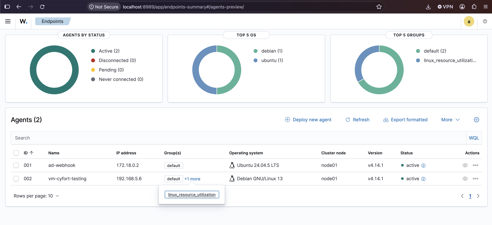

# TCER: GUI - Build and deploy `linux_resource_utilization`

## Relevant test environment and configuration details

- Software deviations: aligned with test specifications.
- Hardware deviations: aligned with test specifications.

## Test execution results

Here we report the results in terms of step-wise alignments or deviations with respect to the expected outcome of the covered test case.

**Test case step 1**: `.env` prepared on the controller host

- ?c5-defect-0: the required IPs and the SMTP host were configured; all passwords were left empty as there was no Wazuh stack deployed.

**Test case step 2**: RADAR GUI up

- ?c5-defect-0: `./radar.sh gui` successfully started the RADAR GUI and login was successful using the displayed URL (which included an authentication token). The expected tabs are present along with "Status" and "Teardown".

**Test case step 3**: Scenario deployment

- ?c5-defect-0: `Linux Resource Utilization (not deployed)` was listed in the scenario dropbox list and the deployment finished with no error lines and with:

```
=== SUCCESS: Wazuh manager and 'linux_resource_utilization' deployment completed ===

[4:29:03 PM] Done.
```

Moreover, the non-existent Wazuh stack was successful deployed and the `.env` file was updated with the generated passwords.

**Test case step 4**: Generate token for agent

- ?c5-defect-0: In the output display, the “Minting enrollment token…” process finished with exit code '0'; a command with the expected format was printed.

**Test case step 5**: Bootstrapping the agent

- ?c5-defect-0: The command copied from step 4 ran successfully in the agent host and printed the expected lines. The Wazuh Dashboard shows that the agent was registered and added to the 'linux_resource_utilization' group.

{: width="80%"}

**Test case step 6**: Check the metric collector

- ?c5-defect-0: the timer is listed and the log messages have the expected format.

**Test case step 7**: Run anomaly detector with ingestion

- ?c5-defect-0: The output contained all the expected messages and no errors.

**Test case step 8**: Agent's metrics reach the controller

-  ?c5-defect-0: the count was greater than 0.

{
  "count" : 476,
  "_shards" : {
    "total" : 4,
    "successful" : 4,
    "skipped" : 0,
    "failed" : 0
  }
}

**Test case step 9**: Detector health check

- ?c5-defect-0: The health check ran for the MANAGER (filesystem/container) and MANAGER (Wazuh API / OpenSearch / webhook), showing "OK" for all the listed resources and exit code '0'.

**Test case step 10**: Cleanup

- ?c5-defect-0: Cleanup executed with the expected outcome.

### Defect summary description

Defect-free test execution, i.e., defect category: - ?c5-defect-0.

### Text execution evidence

See logs and screenshots reported above.

### Comments

N/A

## Guide

- Defect category: ?c5-defect-0; ?c5-defect-1; ?c5-defect-2; ?c5-defect-3; ?c5-defect-4
- Verification method (VM): Test (T), Review of design (R), Inspection (I), Analysis (A)